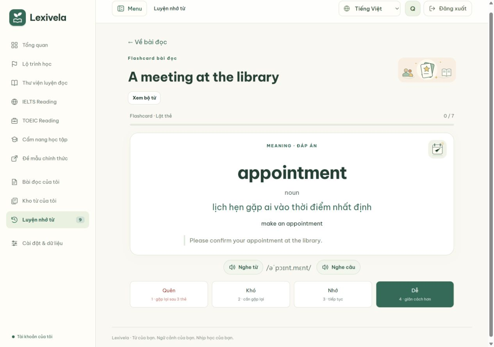

# Flashcard theo bài đọc

Mở bài đọc cá nhân hoặc bài đã mở từ thư viện, bấm **Flashcard bài này**. Website lưu bộ từ và mở thẻ đầu tiên ngay. **Xem bộ từ** mở kho từ với bộ lọc của đúng bài. Thẻ hỗ trợ lật, nghe phát âm, IPA khi có dữ liệu, câu gốc và đánh giá để hẹn ôn lại.

## Nhập bằng prompt: ưu tiên cụm từ

Trong **Nhập bộ từ cá nhân**, prompt ưu tiên collocations, phrasal verbs và cụm diễn đạt trước từ đơn; mặc định tối đa 40 mục, vẫn chọn được 20/60/100. Ngưỡng CEFR áp dụng cho nghĩa của cả cụm, không loại cụm vì các từ thành phần dễ. Không ép số lượng hay tỷ lệ cụm nếu bài không có đủ mục phù hợp.

Trường `word` chứa trọn cụm ở dạng chuẩn, giữ giới từ cần thiết; `context` giữ nguyên câu trong bài kể cả khi động từ chia thì hoặc có thành phần chen giữa. Ví dụ mẫu JSON dùng `meet a deadline` và `take responsibility for`. Không tách các từ thành phần thành nhiều thẻ cùng nghĩa. Synonyms/paraphrases/ghi chú là tùy chọn; không yêu cầu tạo IPA hoặc dịch cả bài.

Đây là hướng dẫn cho AI do người học chọn, không phải bộ nhận diện collocations mới chạy trên máy chủ. Luồng **Flashcard bài này** vẫn chỉ dùng các mục có sẵn trong dữ liệu cục bộ. Đã kiểm tra prompt, ví dụ JSON, nhập/xuất nguyên cụm, chống trùng và 4 ngôn ngữ giao diện; chưa gọi AI trả phí để đánh giá chất lượng trích cụm của từng nhà cung cấp.

## Chọn từ và lưu dữ liệu

- `POST /api/readings/<uuid>/vocabulary-deck/` chọn tối đa 20 từ/cụm từ có nghĩa tiếng Việt sẵn trong phần từ vựng của bài hoặc các bộ từ công khai đã nhập vào database. Ưu tiên từ của bài, cụm từ và từ xuất hiện nhiều lần. Không gọi AI hoặc dịch vụ từ điển bên ngoài.
- So khớp nguyên từ/cụm từ và bảng biến thể của từ điển cục bộ. Không suy diễn từ gốc bằng cách cắt đuôi. Cụm từ không được ghép qua dấu câu.
- Với nhiều nghĩa có sẵn, đối chiếu các từ trong câu với ví dụ của mỗi nghĩa. Nếu điểm bằng nhau thì bỏ qua. Đây là cách chọn theo dữ liệu và ngữ cảnh đơn giản, không bảo đảm hiểu mọi nghĩa của từ; người học vẫn có thể sửa thẻ trong kho từ.
- Câu ví dụ là câu lấy trực tiếp từ bài. Không ghép bản dịch của một ví dụ khác vào câu này. Từ chuyên ngành chưa có nghĩa sẵn sẽ không được tạo; nếu cả bài không có từ phù hợp thì hướng dẫn bôi đen để tra/lưu.
- Thẻ trùng từ + nghĩa dùng chung lịch ôn, nhưng mỗi bài có liên kết và câu gốc riêng. Bấm lại không nhân đôi thẻ hay đặt lại tiến độ. Khóa theo tài khoản và bài để tránh tranh chấp khi gửi lại yêu cầu.
- `GET` cùng URL chỉ đọc thẻ đã lưu, tối đa 100 thẻ mỗi lượt. Không tự tạo dữ liệu khi mở một liên kết. Cả hai phương thức yêu cầu tài khoản sở hữu bài; POST dùng CSRF. Phản hồi private/no-store.
- Cache 5 phút chỉ chứa từ vựng công khai. Không cache bài đọc hoặc kho từ riêng trong cache dùng chung. Không có migration mới.
- Preview ngoại tuyến dùng ví dụ song ngữ được nhúng sẵn, so khớp từ nguyên dạng; không chứa toàn bộ bảng biến thể và từ điển của bản database.

## Kiểm chứng ngày 28/10/2026

- 166 kiểm thử Django đạt trên PostgreSQL test database riêng.
- 19 bộ kiểm thử Node đạt, gồm luồng một bấm, lật thẻ, đánh giá, mở lại, ôn lại, bộ lọc theo bài, lỗi máy chủ và phản hồi khi đã chuyển trang; nội dung HTML không được thực thi.
- 8 kiểm thử mới của backend kiểm tra trích từ, giới hạn, nghĩa mơ hồ, biến thể, ngữ cảnh, cache, quyền sở hữu, CSRF, GET không ghi và giữ lịch ôn khi gặp từ ở bài khác.
- HTTP smoke đạt; không reset tài khoản hay volume QA.
- Trình duyệt: bài tự nhập tạo 7 thẻ, hiển thị IPA/câu gốc, đánh giá được lưu, mở kho từ lọc đúng 7 thẻ; chuyển giao diện Việt/Anh; không tràn ngang ở 390 và 320 px.
- Sửa kiểm thử truy vấn danh mục để phân biệt việc lấy toàn bộ cột JSON với tham chiếu cột trong hàm JSON của SQLite. Kiểm thử liên quan đã chạy lại và đạt.

