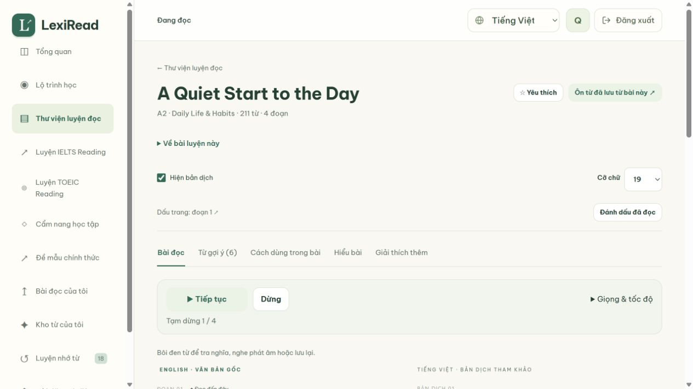
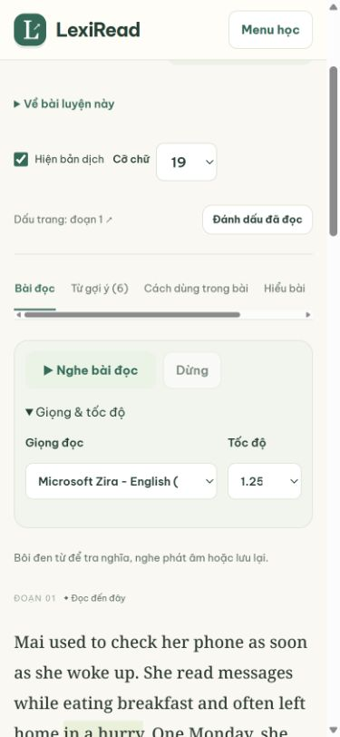

# Nghe bài đọc

Trong tab **Bài đọc**, chọn **Nghe bài đọc** để nghe phần tiếng Anh. Thanh nghe cũng xuất hiện trên các bài TOEIC có văn bản (Part 6–7 và bộ hỗn hợp). Part 5 không có văn bản riêng sẽ không hiện nút nghe.

- Bấm **Tạm dừng / Tiếp tục** hoặc **Dừng** để về đầu bài.
- Mở **Giọng & tốc độ** để chọn giọng tiếng Anh cài trên thiết bị và tốc độ 0,75× / 1× / 1,25× / 1,5×. Hai lựa chọn này được nhớ trong trình duyệt; trạng thái đang phát và nội dung bài không được lưu.
- Đoạn đang đọc được làm nổi. Không cuộn trang tự động và không sửa nội dung, bản dịch hay đáp án.
- Chuyển trang, chuyển tab bài đọc, đổi cách hiển thị bài hoặc đóng trang sẽ dừng âm thanh. Không tự bật lại khi mở bài mới.
- Các nhãn nghe có đủ tiếng Việt, Anh, Pháp và Trung giản thể; đổi ngôn ngữ giao diện trong lúc nghe không đổi tiếng Anh của bài hoặc làm mất vị trí nghe.

## Chi phí và khả năng hỗ trợ

Tính năng dùng Web Speech API, chỉ chọn giọng có `localService === true` và mã ngôn ngữ tiếng Anh. Không gọi AI, dịch vụ tạo audio hoặc API từ điển; không gửi bài đọc riêng tư ra dịch vụ đọc bên ngoài. Không có thay đổi database, migration hoặc gói phụ thuộc chạy trên website.

Giọng và chất lượng phụ thuộc trình duyệt/hệ điều hành. Nếu không có giọng phù hợp, nút nghe bị vô hiệu hóa và hướng dẫn thêm giọng English được hiển thị. Không tự thay bằng giọng từ dịch vụ mạng. Trình duyệt không hỗ trợ được thông báo riêng.

Bài dài được chia thành đoạn phát ngắn, tối đa 220 ký tự, giữ liên kết với đoạn văn gốc. Tạm dừng hủy lượt phát hiện tại; tiếp tục từ ranh giới từ cuối cùng mà trình duyệt báo. Nếu trình duyệt không báo ranh giới, câu/đoạn phát ngắn hiện tại được đọc lại. Lỗi hoặc lượt phát bị treo trả về trạng thái cho phép thử lại. Callback của lượt phát đã hủy không được phép khởi động lại hàng đợi.

Tài liệu API: [SpeechSynthesis](https://developer.mozilla.org/en-US/docs/Web/API/SpeechSynthesis), [localService](https://developer.mozilla.org/en-US/docs/Web/API/SpeechSynthesisVoice/localService), [boundary event](https://developer.mozilla.org/en-US/docs/Web/API/SpeechSynthesisUtterance/boundary_event).

## Kiểm chứng ngày 26/10/2026

- `npm run test:audio`: kiểm thử DOM với speech engine giả lập, bao phủ không tự phát, chỉ chọn giọng local tiếng Anh, giọng tải chậm, tạm dừng/tiếp tục, đổi tốc độ/giọng/ngôn ngữ, ghi nhớ lựa chọn, storage bị chặn, lỗi/timeout, kết thúc, chuyển route, mount lại và xóa host. Bài dài không thiếu chữ.
- Kiểm thử renderer thật: reader chỉ đọc đoạn tiếng Anh, giữ bản dịch; TOEIC chỉ đọc tiêu đề/nội dung tài liệu, không đọc câu hỏi/đáp án, không lặp tài liệu, không hiện thanh nghe khi không có văn bản.
- Toàn bộ 14 file kiểm thử Node đạt; HTTP smoke đạt; build preview và `git diff --check` đạt.
- Browser QA trên Windows: ba giọng English local (Microsoft David, Mark, Zira) xuất hiện. `onstart` được phản ánh qua trạng thái “Đoạn 1 / 4” và highlight đoạn tiếng Anh; Part 7 cũng khởi chạy và highlight văn bản. Thử tạm dừng/tiếp tục, chọn Zira + 1,25×, đổi vi → en → vi, dừng và chuyển trang. Console không ghi nhận lỗi/cảnh báo.
- Kiểm tra bố cục ở viewport 1265 × 712 và 390 × 844; không tràn ngang trên màn hình nhỏ. Đây là xác nhận UI/sự kiện playback, không phải đánh giá chất lượng âm thanh từ loa hay xác nhận trên mọi thiết bị.

