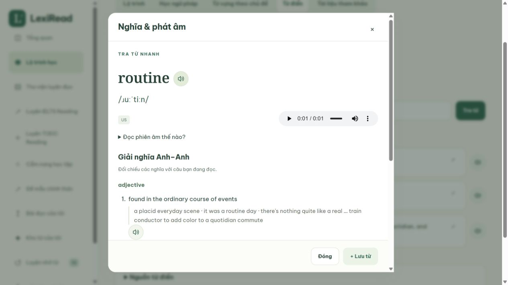
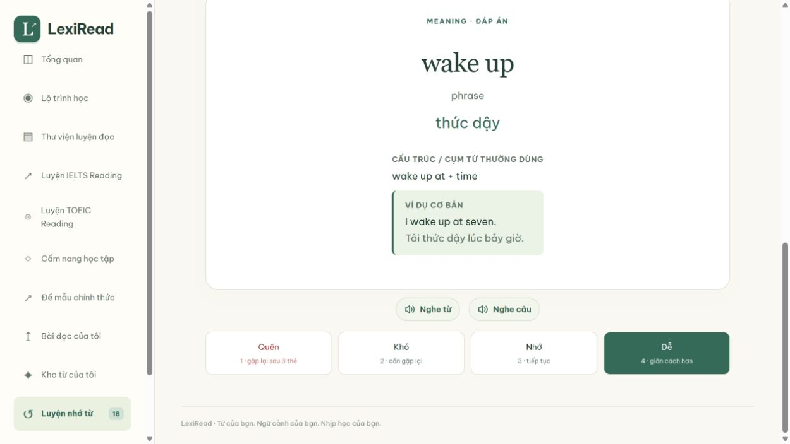
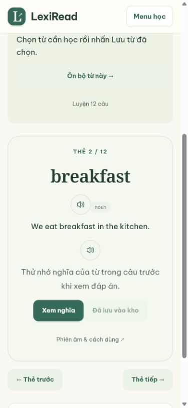

# Nghe bài đọc, từ vựng và câu ví dụ

## Nghe từ và câu ví dụ

Bấm nút loa bên cạnh từ hoặc câu tiếng Anh để nghe; bấm lại để dừng. Nút có tên truy cập đầy đủ và sử dụng được bằng bàn phím. Các vị trí đã hỗ trợ:

- Kết quả tìm từ và hộp tra từ điển, gồm từ đang tra và câu ví dụ Anh–Anh/Anh–Việt.
- Kho từ cá nhân, ví dụ của thẻ, từ gợi ý trong bài đọc và mục từ vựng TOEIC.
- Bộ từ theo chủ đề, cả danh sách và chế độ học bằng thẻ.
- Flashcard ôn tập: **Nghe từ** ở mặt trước; thêm **Nghe câu** khi lật thẻ có ví dụ. Nút nằm ngoài vùng lật thẻ, không thay đổi đáp án hay lịch ôn.
- Câu ví dụ trong bài ngữ pháp, hướng dẫn thì và so sánh thì. Không thêm nút nghe cho đáp án đang ẩn hoặc bài kiểm tra chưa nộp.

Trong hộp từ điển, nút loa ưu tiên bản thu đang có trong database và dùng chung trình phát hiển thị. Khi chưa có bản thu hoặc phát lỗi, dùng giọng English cài trên thiết bị. Các vị trí khác dùng giọng thiết bị, không tra thêm từ hoặc tải audio hàng loạt. Giọng và tốc độ dùng chung lựa chọn ở thanh nghe bài đọc.

Chỉ một nguồn âm thanh phát tại một thời điểm. Nghe từ sẽ dừng bài đọc, và ngược lại, đồng thời giữ nguyên thanh điều khiển để có thể nghe tiếp khi muốn. Chuyển thẻ, ẩn phần đang học, đóng hộp từ điển hoặc chuyển trang sẽ dừng phần phát tương ứng. Nhãn nghe đổi theo bốn ngôn ngữ giao diện; từ, nghĩa cá nhân và ví dụ gốc được giữ nguyên.

Không phát sinh phí AI, không gửi từ/câu riêng tư sang dịch vụ TTS. Giọng thiết bị phụ thuộc hệ điều hành và trình duyệt; nếu thiếu giọng, thông báo hướng dẫn hiện cạnh nút. Các bản thu có sẵn vẫn nghe được khi trình duyệt không hỗ trợ speech synthesis.

### Kiểm chứng phần từ vựng — 27/10/2026

- 15 file kiểm thử Node đạt; `npm run test:audio` chạy cả bài đọc và phát âm. Có kiểm thử DOM/engine cho nguồn audio an toàn, không tự phát, ưu tiên bản thu, dùng chung native player, lỗi/timeout chuyển sang giọng local một lần, callback cũ sau khi dừng, giọng tải chậm, phối hợp các nguồn âm thanh, đóng/ẩn/thay nội dung và đổi ngôn ngữ.
- Kiểm thử renderer thật xác nhận câu tiếng Anh được chọn đúng, không thêm nút vào đáp án ẩn, không lồng nút vào flashcard và không lật thẻ khi bấm loa.
- Browser QA xác nhận sự kiện phát trên ví dụ ngữ pháp; bản thu `routine` từ database (native player thực sự ở trạng thái phát); giọng thiết bị cho `epistemology` không có bản thu; từ/câu trong bộ theo chủ đề và flashcard cá nhân. Đổi vi → en → vi giữ từ và nghĩa gốc. Không nộp bài hay ghi điểm ôn tập trong quá trình này.
- Màn hình 1265 × 712 và 390 × 844: kiểm tra vị trí nút, vùng bấm và không tràn ngang. Console không có lỗi/cảnh báo. HTTP smoke và build preview đạt. Các kiểm tra playback xác nhận sự kiện của trình duyệt, không đánh giá chất lượng loa hoặc bảo đảm mọi hệ điều hành.

## Nghe toàn bài

Trong tab **Bài đọc**, chọn **Nghe bài đọc** để nghe phần tiếng Anh. Thanh nghe cũng xuất hiện trên các bài TOEIC có văn bản (Part 6–7 và bộ hỗn hợp). Part 5 không có văn bản riêng sẽ không hiện nút nghe.

- Bấm **Tạm dừng / Tiếp tục** hoặc **Dừng** để về đầu bài.
- Mở **Giọng & tốc độ** để chọn giọng tiếng Anh cài trên thiết bị và tốc độ 0,75× / 1× / 1,25× / 1,5×. Hai lựa chọn này được nhớ trong trình duyệt; trạng thái đang phát và nội dung bài không được lưu.
- Đoạn đang đọc được làm nổi. Không cuộn trang tự động và không sửa nội dung, bản dịch hay đáp án.
- Chuyển trang, chuyển tab bài đọc, đổi cách hiển thị bài hoặc đóng trang sẽ dừng âm thanh. Không tự bật lại khi mở bài mới.
- Các nhãn nghe có đủ tiếng Việt, Anh, Pháp và Trung giản thể; đổi ngôn ngữ giao diện trong lúc nghe không đổi tiếng Anh của bài hoặc làm mất vị trí nghe.

## Chi phí và khả năng hỗ trợ

Tính năng dùng Web Speech API, chỉ chọn giọng có `localService === true` và mã ngôn ngữ tiếng Anh. Không gọi AI, dịch vụ tạo audio hoặc API từ điển; không gửi bài đọc riêng tư ra dịch vụ đọc bên ngoài. Không có thay đổi database, migration hoặc gói phụ thuộc chạy trên website.

Giọng và chất lượng phụ thuộc trình duyệt/hệ điều hành. Nếu không có giọng phù hợp, nút nghe bị vô hiệu hóa và hướng dẫn thêm giọng English được hiển thị. Không tự thay bằng giọng từ dịch vụ mạng. Trình duyệt không hỗ trợ được thông báo riêng.

Bài dài được chia thành đoạn phát ngắn, tối đa 220 ký tự, giữ liên kết với đoạn văn gốc. Tạm dừng hủy lượt phát hiện tại; tiếp tục từ ranh giới từ cuối cùng mà trình duyệt báo. Nếu trình duyệt không báo ranh giới, câu/đoạn phát ngắn hiện tại được đọc lại. Lỗi hoặc lượt phát bị treo trả về trạng thái cho phép thử lại. Callback của lượt phát đã hủy không được phép khởi động lại hàng đợi.

Tài liệu API: [SpeechSynthesis](https://developer.mozilla.org/en-US/docs/Web/API/SpeechSynthesis), [localService](https://developer.mozilla.org/en-US/docs/Web/API/SpeechSynthesisVoice/localService), [boundary event](https://developer.mozilla.org/en-US/docs/Web/API/SpeechSynthesisUtterance/boundary_event).

## Kiểm chứng ngày 26/10/2026

- `npm run test:audio`: kiểm thử DOM với speech engine giả lập, bao phủ không tự phát, chỉ chọn giọng local tiếng Anh, giọng tải chậm, tạm dừng/tiếp tục, đổi tốc độ/giọng/ngôn ngữ, ghi nhớ lựa chọn, storage bị chặn, lỗi/timeout, kết thúc, chuyển route, mount lại và xóa host. Bài dài không thiếu chữ.
- Kiểm thử renderer thật: reader chỉ đọc đoạn tiếng Anh, giữ bản dịch; TOEIC chỉ đọc tiêu đề/nội dung tài liệu, không đọc câu hỏi/đáp án, không lặp tài liệu, không hiện thanh nghe khi không có văn bản.
- Toàn bộ 14 file kiểm thử Node đạt; HTTP smoke đạt; build preview và `git diff --check` đạt.
- Browser QA trên Windows: ba giọng English local (Microsoft David, Mark, Zira) xuất hiện. `onstart` được phản ánh qua trạng thái “Đoạn 1 / 4” và highlight đoạn tiếng Anh; Part 7 cũng khởi chạy và highlight văn bản. Thử tạm dừng/tiếp tục, chọn Zira + 1,25×, đổi vi → en → vi, dừng và chuyển trang. Console không ghi nhận lỗi/cảnh báo.
- Kiểm tra bố cục ở viewport 1265 × 712 và 390 × 844; không tràn ngang trên màn hình nhỏ. Đây là xác nhận UI/sự kiện playback, không phải đánh giá chất lượng âm thanh từ loa hay xác nhận trên mọi thiết bị.

