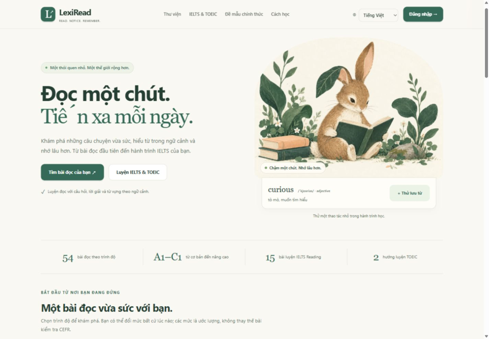
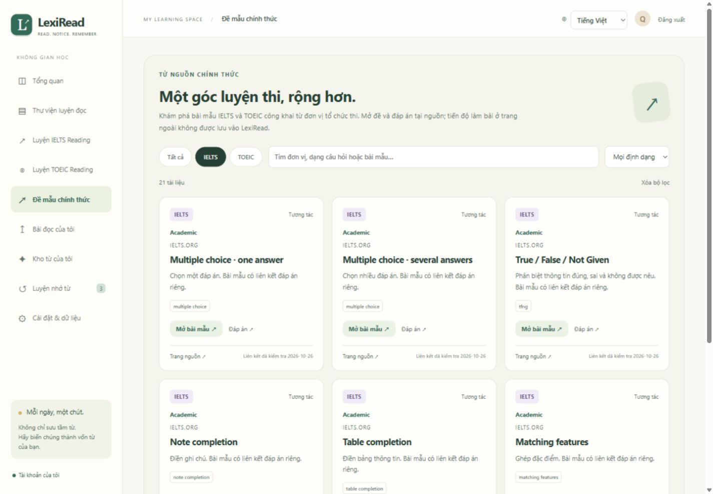

# Bản để kiểm tra — 26/10/2026

## Mở bản hiện tại

- Website QA: http://127.0.0.1:8766/ — trang chào và danh mục công khai.
- Tài khoản thử: `qa-reader` / `LexiRead-QA-2026!`.
- HTML độc lập: mở `preview.html`; có 27 bài đọc và 2 bộ TOEIC đi kèm, lưu trong trình duyệt.
- QA PostgreSQL có 69 bài đọc và 20 bộ TOEIC, gồm bộ nội dung nhập thêm để kiểm thử. Đây không phải số bài đã triển khai trên website thật.

Mã nguồn được lưu bằng commit local để người dùng kiểm tra trước khi push. Chưa push, deploy hoặc thay đổi database production. QA được giữ chạy để xem; nếu cần khởi động lại, xem [lệnh QA](RUNTIME_QA_2026_10_26.md).

## Thay đổi có thể xem

1. Giao diện kem–xanh với hình thỏ tai lá đọc sách riêng của LexiRead, favicon sách/lá, thẻ bài và bố cục điện thoại. Hình được tạo bằng Imagegen, bản WebP 210 KB; [ảnh gốc, prompt và thông tin thiết kế](VISUAL_IDENTITY.md).
2. Mục **Đề mẫu chính thức** dùng được ở trang công khai, trong tài khoản và danh mục HTML: 23 tài nguyên, lọc IELTS/TOEIC/định dạng, tìm kiếm, xem thêm, liên kết đáp án và nguồn. Phân biệt Academic, General Training và TOEIC Bridge. Đây là liên kết tài liệu, không phải 23 đề thi đầy đủ được sao chép vào LexiRead.
3. Công cụ crawl metadata có giới hạn, kiểm tra liên kết, ngày xác minh và provenance; [hướng dẫn nguồn công khai](PUBLIC_RESOURCES.md). Nội dung bên ngoài cần Internet, không đồng bộ tiến độ.
4. Khi chuyển sang trang học khác, màn hình trở về đầu và đưa focus vào nội dung; lọc lại trên cùng trang giữ vị trí. Liên kết bỏ qua điều hướng không làm mất bài đang đọc.
5. Hoàn tất kiểm tra các thay đổi tài khoản, nhập nội dung và lịch học đang có trong workspace; thêm kiểm thử ngày học và danh mục nguồn.

## Kiểm chứng

| Phạm vi | Kết quả |
|---|---|
| Django + PostgreSQL riêng | 89/89 PASS |
| Django + SQLite in-memory | 88 PASS, 1 bỏ qua kiểm thử khóa riêng PostgreSQL |
| Pure Python | 89 PASS, 1 fixture reportlab tùy chọn bỏ qua |
| Node logic / cú pháp JavaScript | PASS |
| Django check / migration drift / static hashing-compression | PASS |
| HTTP: đăng nhập, nội dung, catalog JSON, ảnh/CSS/JS | PASS |
| URL tài liệu/đáp án | 38/40 HTTP 200; 2 PDF British Council xác nhận riêng qua công cụ web |

Full Django suite chạy trước các sửa trình bày cuối; sau bản cuối đã build/restart lại QA và chạy lại 3 test tích hợp danh mục, HTTP smoke và collectstatic. Chi tiết tại [báo cáo runtime](RUNTIME_QA_2026_10_26.md).

Kiểm tra thực tế bằng trình duyệt trong ứng dụng, viewport desktop 1440×1000 và mobile 390×844:

- Landing, hình riêng, demo lưu từ, danh mục tài liệu, lọc TOEIC, tìm không có kết quả, xóa lọc, xem thêm 6→12 và đổi VI/EN hoạt động.
- Đăng nhập bằng tài khoản QA, menu điện thoại, mở *The Red Notebook*, ẩn bản dịch, chọn 3 đáp án và nhận 3/3 với lời giải.
- Lưu từ *garden* vào tài khoản QA, vào ôn theo bài, lật thẻ, chọn **Nhớ**, hoàn tất lượt ôn. Tải lại vẫn ghi nhận mục tiêu ngày 1/20 và một từ đang học.
- Bản sửa chuyển trang được xác nhận `scrollY=0`, focus ở `main`; trang tài liệu có một `h1`. Landing, bài đọc và tài liệu không tràn ngang ở 390 px.
- HTML độc lập tải được hình nhúng, hiển thị 23 tài nguyên, lọc PDF ra 4, đổi sang tiếng Pháp; không có lỗi/warning trong console của các luồng đã thử. Máy chủ tạm chỉ phục vụ HTML đã được dừng.

Đây là smoke test các luồng trên, không phải toàn bộ ma trận trình duyệt. Email khôi phục thật, HTTPS/domain production và tương tác làm/nộp bài của website đề bên ngoài chưa được kiểm thử. Một số bài/thẻ cũ vẫn thiếu ví dụ, cấu trúc hoặc bản dịch; giao diện ghi rõ phần chưa có.

Ảnh điện thoại: [landing](qa/reading-garden-mobile.jpg), [tài liệu](qa/official-resources-mobile.jpg).
